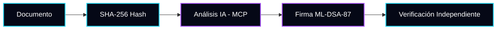

<div align="center">

```text
╔══════════════════════════════════════════════════════════════════════════╗
║   SYCRO VALDOVINOS :: v0.1.0-alpha                                       ║
║   Post-Quantum Trust Layer & AI Agent Infrastructure                     ║
╚══════════════════════════════════════════════════════════════════════════╝
```

https://img.shields.io/badge/Estado-Alpha_v0.1.0-ffcc00?style=for-the-badge&labelColor=050816
https://img.shields.io/badge/Criptograf%C3%ADa-ML--DSA--87-22d3ee?style=for-the-badge&labelColor=050816
https://img.shields.io/badge/Agentes-MCP-a855f7?style=for-the-badge&labelColor=050816
https://img.shields.io/badge/Licencia-Propietaria-ef4444?style=for-the-badge&labelColor=050816

Plataforma de integridad y trazabilidad para evidencia digital. Compatible con NOM-151 y FIPS 204 (no certificado).

</div>

---

📖 Acerca de SYCRO

Los modelos de IA y los sistemas actuales dependen de infraestructuras criptográficas clásicas (RSA/ECDSA) que serán obsoletas frente a la computación cuántica.

SYCRO es un protocolo de infraestructura agéntica diseñado para validar la integridad y autoría de documentos digitales. Utiliza criptografía post-cuántica real (ML-DSA-87) y expone sus capacidades a agentes autónomos mediante el Model Context Protocol (MCP).

🧩 Módulos del ecosistema

Módulo Descripción Estado
Core Crypto Motor de firmas post-cuánticas ML-DSA-87 (NIST FIPS 204). ✅ Implementado
API Bridge Servidor Express con Auth (JWT/Bcrypt), Rate Limiting y CORS. ✅ Implementado
MCP Server Protocolo JSON-RPC para comunicación con agentes de IA. ✅ Implementado
Web UI Dashboard de atestación con Glassmorphism y navegación. ✅ Implementado
CI/CD GitHub Actions con Docker Smoke Test y auditoría de vulnerabilidades. ✅ Implementado
Sellos TSA Integración con autoridades de sellado de tiempo (RFC 3161). ⏳ Planificado
KMS / IPFS Anclaje a AWS S3 Object Lock e IPFS para persistencia. ⏳ Planificado

🧬 Arquitectura y Flujo



🚀 Instalación rápida

```bash
# 1. Clonar el repositorio
git clone https://github.com/Marcorojas17/Marcorojas17.git
cd Marcorojas17

# 2. Instalar dependencias (API, Web y MCP)
cd apps/api && npm install && cd ../..
cd apps/web && npm install && cd ../..
cd kronos-pq && npm install && cd ..

# 3. Configurar variables de entorno (usar .env.example)
cp kronos-pq/.env.example kronos-pq/.env

# 4. Iniciar el Bridge (Web + API + MCP)
cd kronos-pq && node scripts/mcp-bridge.mjs
# Visita http://localhost:4000
```

🔒 Seguridad y Certificaciones

· Criptografía: Implementación compatible con NIST FIPS 204 (ML-DSA-87). No cuenta con certificación formal de NIST ni CMVP.
· Legal: Diseñado para integrarse con flujos NOM-151, pero no sustituye a un Prestador de Servicios de Certificación (PSC) acreditado.
· Auditoría: Cero vulnerabilidades reportadas en dependencias (API, Web y MCP). Smoke test criptográfico incluido en CI.

---

<div align="center">
  <sub>Construido por Marco Antonio Rojas Valdovinos. Código Propietario.</sub>
</div>
