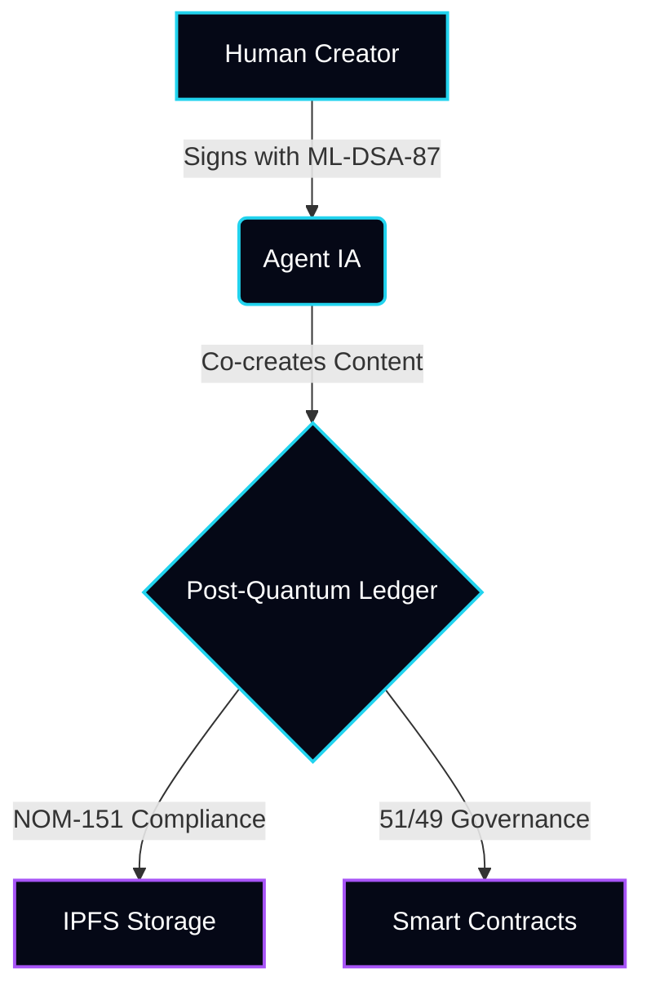

<div align="center">

```bash
[■] SYSTEM BOOT: ARKHÉ ZERO
[■■] 1330 files verified
[■■■] Kintsugi: golden cracks active
[■■■■] Post-Quantum: KYBER/DILITHIUM OK
[■■■■■] 51% Human / 49% AI - VALDOVINOS

  ██╗  ██╗██████╗  ██████╗ ███╗   ██╗ ██████╗ ███████╗
  ██║ ██╔╝██╔══██╗██╔═══██╗████╗  ██║██╔═══██╗██╔════╝
  █████╔╝ ██████╔╝██║   ██║██╔██╗ ██║██║   ██║███████╗
  ██╔═██╗ ██╔══██╗██║   ██║██║╚██╗██║██║   ██║╚════██║
  ██║  ██╗██║  ██║╚██████╔╝██║ ╚████║╚██████╔╝███████║
  ╚═╝  ╚═╝╚═╝  ╚═╝ ╚═════╝ ╚═╝  ╚═══╝ ╚═════╝ ╚══════╝
  
  TOLUCA-GLOBAL | PROTOCOL | POST-QUANTUM
```

<a href="https://git.io/typing-svg">
  
</a>

<br/>


I'm a Senior Engineer building post-quantum infrastructure for AI agents.

</div>

<br/>

<div align="center">
  
  
</div>

<br/>

<!-- WAKATIME START -->

<!--START_SECTION:waka-->


**🐱 My GitHub Data** 

> 📦 75.1 kB Used in GitHub's Storage 
 > 
> 💼 Opted to Hire
 > 
> 📜 57 Public Repositories 
 > 
> 🔑 4 Private Repositories 
 > 
📅 **I'm Most Productive on Thursday** 

```text
Monday                   713 commits         █░░░░░░░░░░░░░░░░░░░░░░░░   04.36 % 
Tuesday                  697 commits         █░░░░░░░░░░░░░░░░░░░░░░░░   04.26 % 
Wednesday                1112 commits        ██░░░░░░░░░░░░░░░░░░░░░░░   06.80 % 
Thursday                 6688 commits        ██████████░░░░░░░░░░░░░░░   40.91 % 
Friday                   4190 commits        ██████░░░░░░░░░░░░░░░░░░░   25.63 % 
Saturday                 2035 commits        ███░░░░░░░░░░░░░░░░░░░░░░   12.45 % 
Sunday                   912 commits         █░░░░░░░░░░░░░░░░░░░░░░░░   05.58 % 
```


📊 **This Week I Spent My Time On** 

```text
🕑︎ Time Zone: America/Mexico_City

💬 Programming Languages: 
No Activity Tracked This Week

🔥 Editors: 
No Activity Tracked This Week

💻 Operating System: 
No Activity Tracked This Week
```

🤖 **AI Coding This Week** 

```text
No AI Coding Activity Tracked This Week
```


<!--END_SECTION:waka-->

<!-- WAKATIME END -->

<br/>

🧬 System Architecture



🎯 Agent Skills Marketplace (Agensi)

Skill Description Status
pq-signature ML-DSA-87 (NIST FIPS 204) post-quantum signatures for AI agents. https://img.shields.io/badge/Status-Live-22d3ee?style=flat-square

<br/>

<div align="center">
  
</div>
