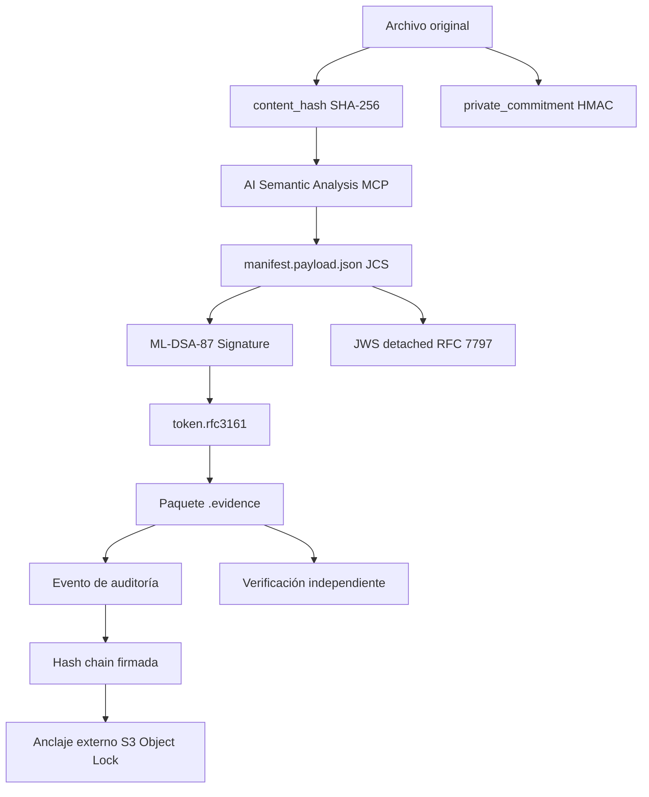

```text
╔══════════════════════════════════════════════════════════════════════════╗
║                                                                          ║
║   ███████╗██╗   ██╗██╗██████╗ ███████╗███╗   ██╗ ██████╗███████╗         ║
║   ██╔════╝██║   ██║██║██╔══██╗██╔════╝████╗  ██║██╔════╝██╔════╝         ║
║   █████╗  ██║   ██║██║██║  ██║█████╗  ██╔██╗ ██║██║     █████╗           ║
║   ██╔══╝  ╚██╗ ██╔╝██║██║  ██║██╔══╝  ██║╚██╗██║██║     ██╔══╝           ║
║   ███████╗ ╚████╔╝ ██║██████╔╝███████╗██║ ╚████║╚██████╗███████╗         ║
║   ╚══════╝  ╚═══╝  ╚═╝╚═════╝ ╚══════╝╚═╝  ╚═══╝ ╚═════╝╚══════╝         ║
║                                                                          ║
║   V A L D O V I N O S   ::   v0.1.0-alpha                                ║
║   cadena de custodia digital + criptografía post-cuántica                ║
║                                                                          ║
╚══════════════════════════════════════════════════════════════════════════╝
```

Plataforma de integridad, trazabilidad y verificación de evidencia digital para México y Latinoamérica, impulsada por IA y Criptografía Post-Cuántica (ML-DSA-87).

```text
[ HASH ]  SHA-256 + HMAC          [ TIME ]  RFC 3161
[ PROOF ] .evidence               [ AUDIT ] Hash Chain
[ FORM  ] JCS RFC 8785            [ SIGN  ] ML-DSA-87 (NIST FIPS 204)
[ PADES ] ETSI EN 319 142-1       [ AGENT ] MCP (Model Context Protocol)
[ KMS   ] Local + AWS             [ ANCHR ] Local + S3 Object Lock
```

https://img.shields.io/badge/estado-pre--alpha-ffcc00?style=for-the-badge&labelColor=0a0d10
https://img.shields.io/badge/n%C3%BAcleo%20criptogr%C3%A1fico-100%25-00ff41?style=for-the-badge&labelColor=0a0d10
https://img.shields.io/badge/api-fastify-00ffff?style=for-the-badge&labelColor=0a0d10
https://img.shields.io/badge/ui-vite-ff00ff?style=for-the-badge&labelColor=0a0d10
https://img.shields.io/badge/tests-unit%20%2B%20security-8b5cf6?style=for-the-badge&labelColor=0a0d10
https://img.shields.io/badge/licencia-MIT%20%2B%20CC--BY--4.0-10b981?style=for-the-badge&labelColor=0a0d10

```text
> WARNING: SYCRO VALDOVINOS no sustituye a abogado, perito, notario
> ni Prestador de Servicios de Certificación (PSC). Los sellos RFC 3161 y
> las constancias NOM-151 son emitidos exclusivamente por terceros
> autorizados.
```

---

```text
┌─[ 01 ]───────────────────────────────────────────────────────────── MISIÓN ─┐
│                                                                             │
│  Preservar evidencia digital de forma verificable, trazable y               │
│  exportable, utilizando criptografía post-cuántica para garantizar          │
│  la integridad a largo plazo (Zero-Trust / Post-Quantum).                   │
│                                                                             │
└─────────────────────────────────────────────────────────────────────────────┘
```

```text
ARCHIVO ORIGINAL
       │
       ├──▶ content_hash       (SHA-256, verificable por terceros)
       ├──▶ private_commitment (HMAC-SHA256 vía KMS, prueba privada)
       ├──▶ post_quantum_sig   (ML-DSA-87, inmune a ataques cuánticos)
       ├──▶ ai_risk_analysis   (Agente IA local, detecta anomalías)
       ├──▶ token.rfc3161      (TSA externa, vinculado al hash)
       ├──▶ evidence-report.pdf (PAdES-B-T: firma + sello de tiempo)
       ├──▶ evento encadenado + anclaje externo
       └──▶ cierre firmado del log de auditoría
       │
       ▼
PAQUETE .evidence VERIFICABLE
```

---

```text
┌─[ 02 ]───────────────────────────────────────────────────────── QUÉ HACE ─┐
│                                                                            │
└────────────────────────────────────────────────────────────────────────────┘
```

Módulo Función
📦 Paquete .evidence Convierte archivos en paquetes verificables e independientes.
🔒 Integridad Calcula content_hash (SHA-256) y private_commitment (HMAC).
🛡️ Post-Quantum Firma el paquete con ML-DSA-87 (NIST FIPS 204).
🤖 IA Agent Servidor MCP que analiza semánticamente el documento antes de firmar.
🕐 Tiempo Integra sellos RFC 3161 emitidos por una TSA externa.
📄 Reporte Genera evidence-report.pdf con firma PAdES-B-T.
⛓️ Auditoría Registra eventos en hash chain con firma por evento.
🔌 API HTTP Expone órdenes, evidencia, webhook y verificación (Fastify).
🖥️ UI Interfaz server-side (Glassmorphism UI) con verificación y checkout.

---

```text
┌─[ 03 ]────────────────────────────────────────────────────── LÍMITES ─┐
│                                                                        │
└────────────────────────────────────────────────────────────────────────┘
```

✅ ESTE SISTEMA SÍ ❌ ESTE SISTEMA NO
Vincula un hash con una fecha/hora verificable mediante token RFC 3161. No certifica autoría, titularidad ni veracidad del contenido.
Conserva artefactos criptográficos (ML-DSA-87) para revisión independiente. No emite constancias NOM-151 (solo un PSC acreditado puede hacerlo).
Mantiene trazabilidad operativa y eventos auditables. No garantiza la admisibilidad judicial de una prueba.
Facilita verificación técnica reproducible por terceros. No sustituye asesoría jurídica, pericial o notarial.

---

```text
┌─[ 04 ]───────────────────────────────────── CONTENIDO DEL PAQUETE ─┐
│                                                                     │
└─────────────────────────────────────────────────────────────────────┘
```

```text
paquete.evidence
├── manifest.payload.json       ← Metadatos y hashes canónicos (JCS, RFC 8785)
├── manifest.jws.json           ← Firma JWS + Firma ML-DSA-87 (Post-Quantum)
├── token.rfc3161               ← Sello de tiempo RFC 3161 (ASN.1 DER)
├── evidence-report.pdf         ← Reporte técnico PAdES-B-T
├── proofs/
│   ├── chain_<position>.json   ← Entrada de hash chain
│   └── anchor_<position>.json  ← Anclaje externo (S3 Object Lock)
├── signatures/
│   ├── signing_cert.pem        ← Certificado de firma
│   └── pq_signature.bin        ← Firma Post-Cuántica (4627 bytes)
├── ai_audit/
│   └── analysis.json           ← Resultado del agente IA (Nivel de riesgo)
└── README.txt                  ← Instrucciones de verificación
```

---

```text
┌─[ 05 ]────────────────────────────────── ARQUITECTURA DE CONFIANZA ─┐
│                                                                     │
└─────────────────────────────────────────────────────────────────────┘
```



Naturaleza de las pruebas

Elemento Naturaleza Verificable por
content_hash (SHA-256) Prueba pública e interoperable Cualquiera con el archivo original
pq_signature (ML-DSA-87) Prueba criptográfica post-cuántica Cualquiera con la clave pública
token.rfc3161 Vinculación temporal emitida por TSA externa Cualquiera con el token
ai_audit/analysis.json Análisis de riesgo semántico automatizado El operador del sistema
audit.log.jsonl Log encadenado con firma por evento Cualquiera con la clave pública

---

```text
┌─[ 06 ]─────────────────────────────────────── ESTADO DEL PROYECTO ─┐
│                                                                     │
└─────────────────────────────────────────────────────────────────────┘
```

Componente Estado
Núcleo criptográfico (PQ) ✅ ML-DSA-87, hashing, KMS, JCS, manifest, JWS
Servidor MCP e IA ✅ Análisis semántico y firma vía protocolo de agentes
Log de auditoría ✅ logger encadenado + anclaje (Local+S3) + verificación
Empaquetado .evidence ✅ builder + verifier + CLI
API HTTP ✅ Fastify: orders, evidence, webhook, admin, JWT Auth
UI de aplicación ✅ Glassmorphism Dashboard (Vite)
CI/CD ✅ GitHub Actions + Dockerfile multi-stage
Revisión legal MX ⚠️ Bloqueante externo

Barra de progreso

```text
  Núcleo criptográfico  ████████████████████████████████████ 100%
  Servidor MCP / IA     ████████████████████████████████████ 100%
  Log de auditoría      ████████████████████████████████████ 100%
  Empaquetado .evidence ████████████████████████████████████ 100%
  API HTTP + JWT        ████████████████████████████████████ 100%
  UI Dashboard (Luxury) ████████████████████████████████████ 100%
  CI/CD y Docker        ████████████████████████████████████ 100%
  Revisión legal MX     ░░░░░░░░░░░░░░░░░░░░░░░░░░░░░░░░░░░░   0%
```

---

```text
╔══════════════════════════════════════════════════════════════════════════╗
║                                                                          ║
║   [ SYCRO VALDOVINOS ]                                                   ║
║                                                                          ║
║   Integridad verificable.                                                ║
║   Trazabilidad responsable.                                              ║
║   Criptografía Post-Cuántica.                                            ║
║                                                                          ║
║   root@sycro:~# ./verify --integrity --post-quantum                      ║
║   █                                                                      ║
║                                                                          ║
╚══════════════════════════════════════════════════════════════════════════╝
```

